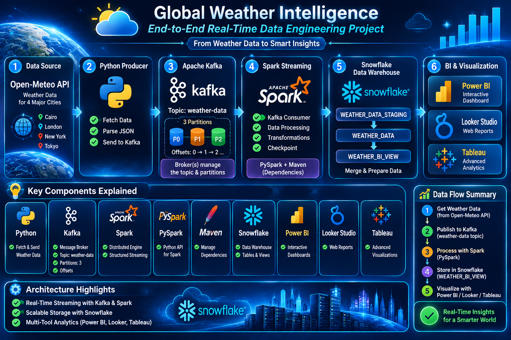

# 🌦️ Global Weather Intelligence
### ⚡ End-to-End Real-Time Weather Data Engineering Pipeline

An end-to-end real-time weather data engineering project that collects weather data from multiple cities, streams it through Apache Kafka, processes it using Apache Spark Structured Streaming, and stores the processed data in Snowflake for business intelligence and analytics.

The project demonstrates how modern data engineering technologies work together to build a scalable streaming pipeline, from data ingestion to data visualization.

---

## 🏗️ System Architecture

The following diagram illustrates the complete architecture, data flow, and technologies used throughout the project.

<p align="center">
  
</p>

---
## 🛠️ Technologies & Tools

The project uses the following technologies:

| Technology | Purpose |
|---|---|
| Python | Weather data extraction and Kafka producer |
| Open-Meteo API | External weather data source |
| Apache Kafka | Real-time data streaming and message buffering |
| Kafka-Python | Python integration with Kafka |
| Apache Spark | Distributed stream processing |
| Spark Structured Streaming | Continuous processing of Kafka messages |
| PySpark | Data transformation and processing |
| Snowflake | Cloud data warehouse |
| Snowflake Connector | Data loading and warehouse integration |
| RSA Key Pair Authentication | Secure Snowflake authentication |
| SQL | Data merging and warehouse operations |
| Power BI | Business intelligence and visualization |
| Looker Studio | Interactive data visualization |
| Tableau | Data visualization and analytics |
| Git & GitHub | Version control and project hosting |
| VMware | Ubuntu development environment |

---
## 🔄 End-to-End Data Flow

The pipeline consists of several interconnected stages:

### 1. Data Ingestion – Open-Meteo API & Python

- Retrieves weather data from the Open-Meteo API.
- Collects current weather observations for four major cities:
  - Cairo
  - London
  - Tokyo
  - New York
- Extracts temperature, humidity, apparent temperature, and other weather metrics.
- Python handles API requests and prepares records for streaming.

### 2. Real-Time Streaming – Apache Kafka

- A Python Kafka Producer publishes weather records to Kafka.
- Messages are sent to the `weather-data` topic.
- Kafka acts as a distributed messaging layer between ingestion and processing.

### 3. Stream Processing – Apache Spark

- Spark Structured Streaming consumes messages from Kafka.
- PySpark processes and transforms incoming weather records.
- A checkpoint mechanism maintains streaming progress and supports recovery.
- The streaming query uses a 60-second processing-time trigger.

### 4. Data Warehousing – Snowflake

- Spark writes processed micro-batches into the Snowflake staging table.
- SQL MERGE operations transfer new records into the main weather table.
- Staging data is cleaned up after successful processing.
- Snowflake stores the processed data for analytical queries.

### 5. Business Intelligence – BI Tools

- A dedicated Snowflake BI View provides an analytical data source.
- Power BI, Looker Studio, and Tableau are intended for interactive dashboards and weather analytics.

---
## 🧩 Key Components Explained

### 🐍 Python Producer
- Connects to the weather extraction module.
- Retrieves weather records from the Open-Meteo API.
- Publishes structured weather messages to Kafka.

### 📨 Apache Kafka
- Acts as the messaging backbone of the pipeline.
- Decouples data ingestion from stream processing.
- Buffers incoming records before Spark consumes them.
- Uses the `weather-data` topic with three partitions.

### ⚡ Spark Structured Streaming
- Reads streaming messages directly from Kafka.
- Parses and transforms incoming weather records.
- Processes data in micro-batches.
- Uses checkpointing to support recovery.
- Executes processing triggers every 60 seconds.

### ❄️  Snowflake
- Stores processed weather observations.
- Uses a staging table as an intermediate loading layer.
- Applies SQL MERGE operations to synchronize staging data with the main table.
- Provides an analytical view for BI tools.

---

## ☁️ Snowflake Data Warehouse

The project uses Snowflake as its cloud data warehouse.

### Database Configuration

| Object | Name |
|---|---|
| Database | `WEATHER_DB` |
| Schema | `WEATHER_SCHEMA` |
| Warehouse | `WEATHER_WH` |
| Main Table | `WEATHER_DATA` |
| Staging Table | `WEATHER_DATA_STAGING` |
| BI View | `WEATHER_BI_VIEW` |

### Data Loading Strategy

The pipeline follows a staging-and-merge approach:

1. Spark writes each processed micro-batch into `WEATHER_DATA_STAGING`.
2. A SQL MERGE statement synchronizes staging records with `WEATHER_DATA`.
3. Successfully processed staging records are cleaned up.
4. The BI View exposes weather data in an analytics-friendly structure.

### Weather Metrics

The analytical dataset includes:

- City
- Latitude and Longitude
- Temperature
- Humidity
- Apparent Temperature
- Precipitation
- Weather Code
- Wind Speed
- Pressure
- Observation Timestamp
- Extraction Timestamp
- Weather Date and Hour

---

## 📁 Project Structure

```text
Weather-Data-Engineering/
│
├── config/
│   └── snowflake_config.py
│
├── data/
│   └── weather_data.json
│
├── docs/
│   └── images/
│       └── global_weather_architecture.png
│
├── ingestion/
│   ├── weather_api.py
│   └── kafka_producer.py
│
├── processing/
│   └── spark_kafka_stream.py
│
├── secrets/                  # Excluded from Git
├── checkpoints/              # Excluded from Git
├── venv/                      # Excluded from Git
│
├── test_snowflake_connection.py
├── test_snowflake_spark.py
├── test_spark_snowflake_connection.py
│
├── requirements.txt
├── .gitignore
└── README.md
```

---

## 🚀 Installation & Setup

### Prerequisites

Make sure the following tools are installed:

- Python 3.10+
- Java (compatible with Spark 3.5.3)
- Apache Kafka
- Apache Spark 3.5.3
- Snowflake account
- Git

### 1. Clone the Repository

```bash
git clone https://github.com/0Mariam-Salem0/Global-Weather-Intelligence.git
cd Global-Weather-Intelligence
```

### 2. Create a Virtual Environment

```bash
python3 -m venv venv
source venv/bin/activate
```

### 3. Install Dependencies

```bash
pip install -r requirements.txt
```

### 4. Configure Snowflake Credentials

Configure the following environment variables using your own Snowflake credentials:

```text
SNOWFLAKE_ACCOUNT=
SNOWFLAKE_USER=
SNOWFLAKE_WAREHOUSE=
SNOWFLAKE_DATABASE=
SNOWFLAKE_SCHEMA=
SNOWFLAKE_ROLE=
SNOWFLAKE_PRIVATE_KEY_PATH=
SNOWFLAKE_PRIVATE_KEY_PASSPHRASE=
```

Never upload credentials or private keys to GitHub.

### 5. Start the Streaming Pipeline

Start Kafka and Spark, configure the `weather-data` topic with three partitions, and ensure Snowflake is accessible.

Run the Python producer:

```bash
python -m ingestion.kafka_producer
```

Run the Spark Structured Streaming application:

```bash
python processing/spark_kafka_stream.py
```

---

## 🔐 Security

Security practices implemented in this project include:

- RSA Key Pair Authentication for Snowflake.
- Environment-based configuration for credentials.
- Private keys and secret files excluded through `.gitignore`.
- Virtual environments excluded from version control.
- Spark checkpoints and temporary files excluded from Git.

Never commit passwords, tokens, private keys, or environment files.

---

## 📊 Business Intelligence & Dashboards

Processed weather data is exposed through the Snowflake BI View to support interactive analytics and visualization.

| BI Tool | Status |
|---|---|
| Power BI | In Progress |
| Looker Studio | Planned |
| Tableau | Planned |

Dashboard screenshots and links will be added as each dashboard is completed.

---

## 🔮 Future Improvements

- Complete interactive dashboards across Power BI, Looker Studio, and Tableau.
- Add advanced weather trend analysis.
- Implement automated data quality checks.
- Introduce pipeline monitoring and alerting.
- Expand the pipeline to support additional cities and weather metrics.

---

## 👩‍💻 Author

**Mariam Salem**

Data Engineering | Streaming Data Pipelines | Cloud Data Warehousing | Business Intelligence

---

⭐ If you find this project interesting, feel free to star the repository!
